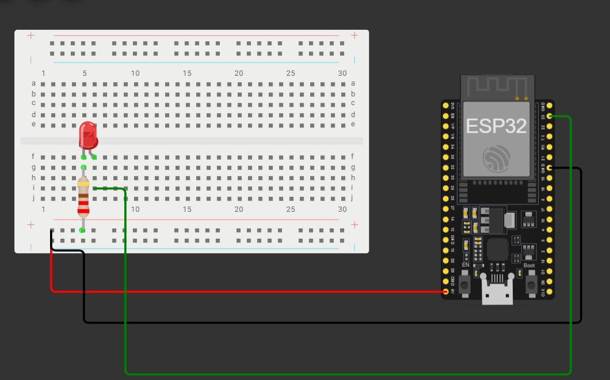
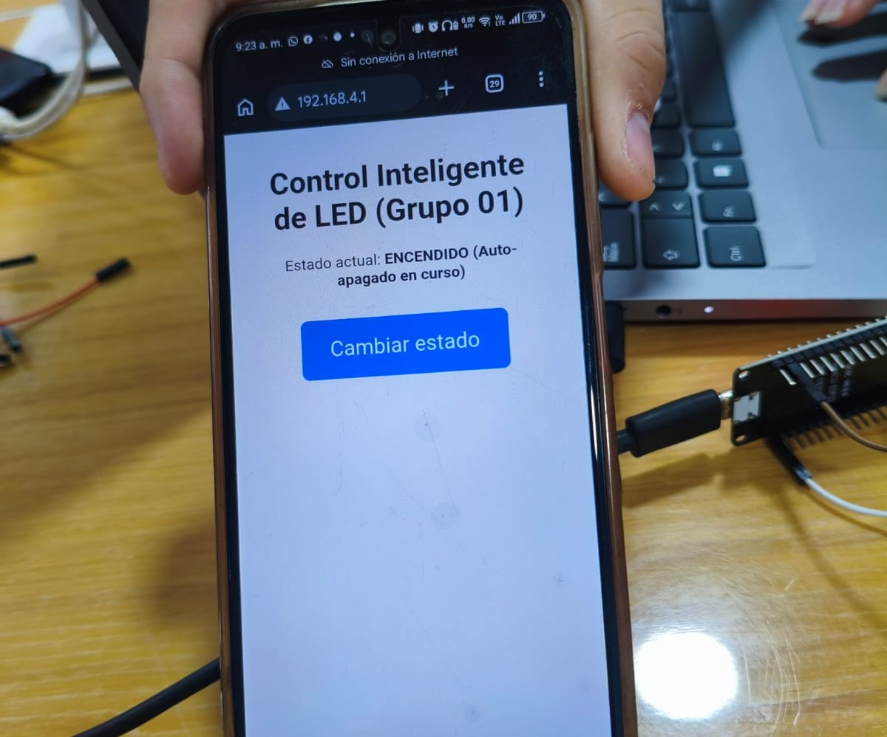
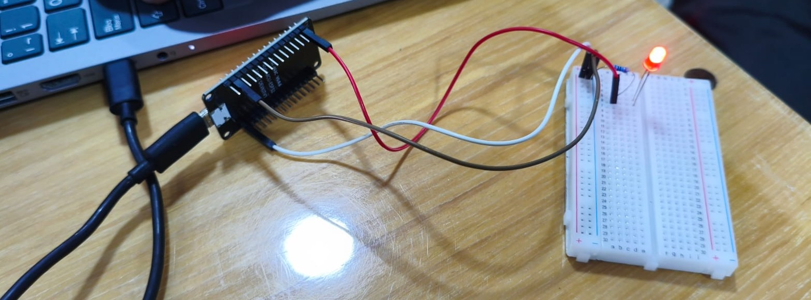

# Control Inalámbrico de un LED con ESP32 (Servidor Web Local y Retos)

## Información General e Institucional

* **Universidad / Institución:** Universidad Americana
* **Asignatura:** Fundamentos de Mecatrónica
* **Docente / Profesor:** Eduardo Pimienta Leon
* **Semestre / Grupo:** Grupo 3A
* **Año:** 2026
* **Estudiantes / Integrantes:**  
  * Sebastian De Luque
  * Camilo Martinez
  * Martin Castro
  * Sebastian Martinez
  * Yeimer Ortiz
  * Alberto Fandino


## 1. Problema y Objetivo
* **Propósito:** Encender y apagar un LED desde el navegador web de un teléfono celular de manera inalámbrica, sin depender de redes de Internet institucionales. El ESP32 genera su propia red Wi-Fi y aloja un servidor web que gestiona solicitudes HTTP.
* **Competencias a adquirir:** Identificar ánodo y cátodo en diodos LED, montar circuitos en serie con resistencia limitadora de corriente, configurar pines GPIO como salidas digitales, programar un servidor HTTP en el ESP32, interpretar direcciones IP locales (`192.168.4.1`) y comprender la comunicación cliente-servidor en sistemas embebidos.


## 2. Materiales y Componentes

| Cantidad | Elemento | Función |
| :---: | :--- | :--- |
| 1 | ESP32 DevKit / ESP32-WROOM-32 | Microcontrolador central y servidor web |
| 1 | LED rojo | Indicador visual de estado |
| 1 | Resistencia de 220 Ω | Limita la corriente y protege el GPIO |
| 1 | Protoboard | Plataforma de montaje físico |
| 2-3 | Cables Dupont | Enlaces y conexiones eléctricas |
| 1 | Cable USB de datos | Programación y alimentación energética |
| 1 | Computador con Arduino IDE | Entorno de desarrollo para carga del sketch |
| 1 | Teléfono inteligente con Wi-Fi | Interfaz de control inalámbrico |


## 3. Montaje Eléctrico

Conecta los componentes en serie siguiendo estrictamente esta ruta (desconecta el USB antes de armar):

```text
GPIO23 del ESP32 --- [ 220 ohmios ] --- |>| --- GND del ESP32
                                          LED
                                   anodo -> catodo
```

## 4. Conexión del circuito LED

1. Ubica el pin GPIO 23 (o GPIO 18 si aplicas la variante del Reto 1).
2. Conecta un cable desde dicho pin hacia una terminal de la resistencia de 220 Ω.
3. Conecta el otro extremo de la resistencia a la pata larga (Ánodo +) del LED.
4. Conecta la pata corta (Cátodo -) del LED directamente a una línea de GND.

## **5. Código Fuente del Proyecto**

El código fuente completo con la resolución de los tres retos de programación se encuentra disponible en el siguiente archivo:

**[Código fuente completo](./codigo_led.ino)**

Este archivo contiene la programación del ESP32, la configuración de la red Wi-Fi, el servidor web y la lógica de control del LED.


## 5. Detalle y Explicación de los Retos de Programación

### Reto 1: Identidad propia de la red y personalización de hardware

**Descripción:**

Cada equipo de trabajo debe configurar un SSID exclusivo que incluya su número de grupo (ej. `ESP32_LED_G01`). Asimismo, se exige migrar el circuito y el software del GPIO23 al GPIO18.

**Explicación técnica:**

A nivel de software, se modifica la variable `NOMBRE_RED`.

A nivel físico, no bastaba con cambiar únicamente el código, ya que el microcontrolador necesita enviar la señal eléctrica por un canal físico diferente. Por ello, fue obligatorio mover físicamente el cable Dupont del pin 23 al pin 18 en la protoboard, asegurando que la directiva `const int PIN_LED = 18;` coincidiera plenamente con el hardware cableado.

### Reto 2: Un solo botón para alternar (Lógica de conmutación)

**Descripción:**

Reemplazar los dos botones independientes ("Encender" y "Apagar") por un único botón interactivo en la interfaz web titulado "Cambiar estado".

**Explicación técnica:**

Se rediseñó la estructura HTML incluyendo un único formulario que apunta hacia la ruta HTTP POST `/alternar`.

Cada vez que el usuario presiona el botón desde su celular, el navegador efectúa una petición HTTP POST a dicha ruta. El servidor ejecuta la función `alternarLED()`, la cual utiliza el operador lógico de negación (`!`) para invertir el valor booleano actual:

```cpp
ledEncendido = !ledEncendido;

```

De este modo, si estaba apagado se enciende, y si estaba encendido se apaga de manera automática.


## Reto 3: Autoapagado sin bloquear el servidor (Temporizador no bloqueante)

**Descripción:**

Hacer que el LED se apague automáticamente transcurridos 10 segundos desde su encendido, garantizando que durante ese intervalo la interfaz web continúe respondiendo a peticiones sin sufrir bloqueos.

**Explicación técnica:**

**Problema del código bloqueante (`delay`):**

Si se utilizara un `delay(10000)`, el procesador del ESP32 se congelaría por completo durante 10 segundos, impidiendo atender nuevas solicitudes del servidor web.

**Solución no bloqueante (`millis`):**

Se implementa la función `millis()`, que mide el tiempo en milisegundos desde el arranque de la placa. Al encender el LED, se captura una marca temporal guardada en:

```cpp
tiempoEncendido = millis();
```

En el bucle principal `loop()`, se evalúa de manera constante si la diferencia entre el tiempo actual y la marca supera o iguala los 10,000 ms:

```cpp
millis() - tiempoEncendido >= 10000
```

Si se cumple, el LED se apaga digitalmente. Si el usuario vuelve a encender el LED antes de cumplirse el plazo, el cronómetro se reinicia de inmediato.

## 6. Instrucciones de Validación y Prueba

1. Conecta los componentes en la protoboard respetando el diagrama serie con la resistencia de 220 Ω.

2. Compila y carga el programa mediante el Arduino IDE seleccionando la placa `ESP32 Dev Module`.

3. En tu teléfono inteligente, dirígete a las conexiones Wi-Fi, busca y conéctate a la red `ESP32_LED_G01` introduciendo la clave `Mecatronica2026`.

4. Abre el navegador web del celular e ingresa estrictamente a la dirección IP local:

   `http://192.168.4.1`

5. Interactúa con el botón de control para verificar el funcionamiento del LED físico, la respuesta del servidor y el autoapagado transcurridos los 10 segundos.

## 7. Evidencias del proyecto

A continuación, se presentan las evidencias del montaje físico, el esquema eléctrico y las pruebas de funcionamiento del proyecto.


### **4.1. Esquema eléctrico**



### **4.2. Evidencia del funcionamiento de los botones**



### **4.3. Montaje físico del circuito**



